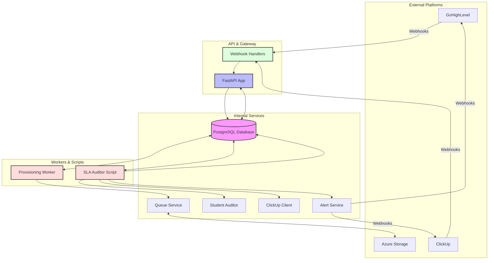

# PulseOps-Engine Architecture

This diagram illustrates the high-level architecture of the PulseOps-Engine system, highlighting the flow of data between external services, internal workers, and the core database.

## Component Breakdown

### API Layer
- **Webhook Handlers**: Ingests data from GoHighLevel and ClickUp, performing initial validation and routing.
- **FastAPI App**: Provides the primary interface for data persistence and internal state management.

### Core Services
- **Student Auditor**: Analyzes student records for SLA breaches and operational sync errors.
- **Alert Service**: Dispatches notifications (e.g., Slack/Webhooks) to CSMs and internal channels.
- **ClickUp Client**: Standardized interface for interacting with ClickUp's REST API.
- **Queue Service**: Manages the asynchronous processing of provisioning tasks via Azure Storage Queues.

### Processing Layer
- **Provisioning Worker**: A background process that handles the side-effects of student onboarding (e.g., creating records in third-party apps).
- **SLA Auditor Script**: A cron-compatible script that runs periodically to scan the whole student database for risks.

### Data Store
- **PostgreSQL Database**: The central source of truth for all student-lifecycle data, statuses, and audit logs.
